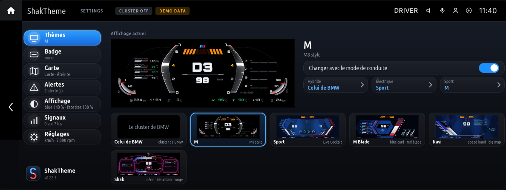

<p align="center"></p>

# ShakTheme

**ShakTheme**, par shakzer : cinq thèmes pour le cluster de l'iDrive 7 d'une **BMW X3 30e (G01, 2022)**, un hybride rechargeable. **Sport**, **M**, **M Blade**, **Navi** et **Shak** (le sien : son logo, néon magenta, bandes de blocs tendues), avec la batterie et l'autonomie électrique, les vrais modes de conduite de la voiture, une fenêtre pour la carte Waze, des températures d'huile et de liquide qui changent de couleur, et un menu au style de l'iDrive 8.5.

Le dépôt contient aussi **ShakHUD** (l'affichage tête haute), **ShakLimites** (la limitation d'après la carte), **RideTube** et deux applis d'essai (ShakConso, ShakMusique). Rien ici n'est officiel BMW.

<p align="center"></p>

> **Important : rien n'a encore été essayé dans une vraie X3 30e.** Tout a été vérifié sur un banc d'essai (rendu image par image des thèmes) et par des tests automatiques. Les points non vérifiés sont listés plus bas, honnêtement.

## Ce que contient le dépôt

| Dossier | Apps | Licence |
|---|---|---|
| `bimmer/` | **ShakTheme** (4 thèmes du cluster), **ShakHUD** (le HUD), **ShakLimites**, **ShakConso**, **ShakMusique**, **RideTube cluster** | MIT (voir `LICENSES.md`) |

À installer à côté, depuis leur propre source du Store (non copiés ici, non modifiés) :

- [robertnisipeanu/idrive-apps](https://github.com/robertnisipeanu/idrive-apps) : **cluster-render** (obligatoire, tout passe par lui) et **Waze on cluster** (la carte Waze dans le cluster ou le HUD).

## Ce qui a été adapté pour le X3 30e

**Modes de conduite.** Le X3 30e n'a pas de Comfort. Tous ses modes sont reconnus : Hybrid, Battery Control, Electric, Hybrid Eco Pro, Electric Individual, Sport, Sport Individual, Sport Plus et Xtraboost. Pour changer de thème, ils sont regroupés en trois créneaux : **Hybrid Eco Pro** (avec Electric et Electric Individual), **Hybrid** (avec Battery Control), **Sport Plus** (avec Sport, Sport Individual et Xtraboost). Dans les réglages de ShakTheme et de HUD Widgets, « Change with the drive mode » choisit un thème par créneau. Par défaut : Sport Plus → thème M, Hybrid Eco Pro → thème Sport, Hybrid → cluster d'origine de BMW (thème désactivé). Le vrai nom du mode, tel que l'écran de la voiture le nomme, est aussi écrit en petit en bas à droite dans les thèmes du cluster.

**Texte « ONE OF ONE » sur le thème Sport.** Réglage « Sport theme: lettering at the top » de ShakTheme : 13 versions (« ONE OF ONE », « 1/1 EDITION »…) en dégradé aux couleurs du thème M, petites, en haut au centre du thème Sport. Par défaut : la version 4b (ONE / OF / ONE empilé, droit et léger). C'est un lettrage à nous, pas un logo de marque ; il disparaît quand la carte Waze s'affiche dans le thème.

**Batterie et autonomie.** À la place de la température d'huile : le niveau de la batterie haute tension (%) et l'autonomie électrique (km), avec barre ou jauge, dans tous les thèmes et dispositions, M et Sport en priorité. L'autonomie vient de la voiture quand elle l'envoie (`displayRangeElectricVehicle`), sinon c'est la charge multipliée par l'autonomie pleine (réglage « Electric range when full », 40 km par défaut). Réservoir 50 L, moteur thermique 300 Nm / 135 kW par défaut.

**Fond bleu nuit à facettes (Sport, M Blade, Navi).** Plus de fond noir : tout le panneau est bleu nuit, avec une lueur plus claire au centre et un motif de losanges à facettes en deux panneaux symétriques, comme la vue Sport d'origine (d'après ta photo). Sur Sport, l'intérieur des arcs est un peu plus clair que l'extérieur. Les mêmes facettes sont dans M Blade et Navi, à la place du noir. La case noire que BMW dessine elle-même à l'emplacement du rapport (1406–1597 × 342–419) ne peut pas être enlevée : le fond l'entoure d'une fenêtre sombre arrondie avec une ombre douce, pour qu'elle ne se voie pas comme un rectangle dur (sans liseré), et la fenêtre de la carte reste transparente (mesuré : 0 pixel allumé dans la fenêtre, 0 sous le capot). Réglage « Blue background (Sport, M Blade, Navi) » (anciennement « Sport theme: blue background », même clé `sportTint`, 80 % par défaut, de 0 = noir à 140 %) : la voiture éclaircit les teintes sombres, ajuste-le à l'œil ; à 0 les trois thèmes redeviennent noirs. Pas testé sur la voiture. Le thème M n'a pas changé de fond (noir), à ta demande. Réglage « Backdrop facets (Sport, M Blade, Navi) » (`sportFacets`, 100 % par défaut, de 0 à 100) : la force des losanges à facettes ; à 0 le fond est un bleu nuit uni, à 100 les facettes sont bien marquées (vérifié sur le banc à 0, 50 et 100 % pour les trois thèmes). La barre bleu/rouge du bas du thème Sport est remontée : elle recouvrait la zone du voyant de ceinture (587–626 × 663–700), d'où les pixels noirs autour ; `tools/test_belt_clear.js` vérifie que plus rien ne dessine dans cette zone ni dans la case noire du rapport BMW.

**Shak Musique (0.1.0, pas encore essayée sur la voiture).** Un lecteur de musique par-dessus le service de RideTube : tu cherches un titre ou un artiste, le son sort par le lecteur multimédia de la voiture, avec la pochette, la progression, précédent et suivant, une file d'attente et les derniers morceaux joués. Il faut le service « RideTube service » installé depuis le Store, internet dans la voiture, et **fermer RideTube** pendant ce temps (le service ne parle qu'à une appli à la fois). Rien n'est gardé : le service efface chaque morceau après lecture. Ce n'est pas un lecteur Spotify : les morceaux téléchargés de Spotify ne se lisent que dans l'appli Spotify.

**Stabilité (ShakTheme 0.21.26, ShakHUD 0.6.31).** Une erreur que personne n'a rattrapée ne ferme plus l'appli (`shared/survive.js` : sur la voiture, une sortie imprévue efface les réglages et la deuxième désinstalle l'appli) ; elle est comptée et affichée dans l'onglet Signaux (« Erreurs rattrapées »). Le thème n'est refait qu'une fois toutes les 400 ms au plus, il est refait tout seul quand cluster-render a refusé une couche, la liaison avec cluster-render se reprend si le service ne répond plus ou ne lit plus, et un recul de l'horloge de la voiture ne fige plus rien. Détails : `CHANGELOG.md`, test `bimmer/tools/test_reliability.js`.

**Vues qui défilent : jauges, pneus, conduite (ShakTheme 0.21.23).** Le réglage « Vue dans le thème » (onglet Affichage, `viewSel`) montre, au choix, une seule de ces vues dans la partie libre de l'écran, dans le style de chaque thème : **Jauges** (barres d'huile, de liquide et de turbo : Sport trois barres inclinées au centre, M trois barres fines sous les valeurs du bas, Navi une colonne de barres fines à droite), **Pneus** (pression et température aux quatre coins ; M a déjà son bloc) et **Conduite** (en mode Sport le G-mètre avec la g de côté et en long ; dans les autres modes quatre rangées moteur, châssis, direction et boîte avec leur réglage du mode, comme les réglages Individual de BMW ; pas dans M, qui a déjà ces rangées). Bleu tant que c'est froid, vert une fois chaud, rouge qui flashe au-dessus des limites d'alerte ; le turbo est bleu clair. **M Blade** fait comme le combiné M de BMW (ShakTheme 0.21.24) : la vue s'ouvre dans un panneau bleu à gauche, l'hexagone prolongé jusqu'à une pointe, à la place de l'échelle de vitesse (Jauges : turbo, huile, liquide et extérieur en barres graduées avec leur valeur ; Conduite : les réglages avec leur niveau en trois crans) ; la jauge d'essence passe alors à droite avec son autonomie, et avec la carte Waze les vues restent en haut à droite. `Aucune` (par défaut) laisse le thème comme avant. Le moteur sait faire défiler les vues (aucune, jauges, pneus, conduite, aucune) ; le bouton derrière le volant n'est pas encore branché, faute de connaître son signal : quatre petites applis d'essai (`shakvolant`, `shakmanette`, `shakconso`, `shakmedia`) affichent ce que la voiture répond pour le retrouver. Le fond bleu est à 140 % par défaut (M Blade a un bleu nuit plus clair).

**Températures dans le thème M.** La rangée du bas, à droite, montre maintenant, de gauche à droite : la température d'huile, celle du liquide de refroidissement, la température extérieure, puis l'autonomie électrique en km juste sous la jauge de batterie (le pourcentage exact n'y est plus, la jauge le donne). L'huile et le liquide sont **bleus** tant qu'ils sont froids (moins de 75 °C pour l'huile, 70 °C pour le liquide, réglables : « Oil temperature: blue below », « Coolant temperature: blue below », onglet Alerts), **verts** une fois chauds, et **rouge vif qui flashe** (rouge vif et rouge sombre, sans blanc) au-dessus de la limite d'alerte (130 °C et 115 °C par défaut, réglages « Oil / Coolant temperature warning »). Test : `tools/test_temp_colours.js`. Vérifié sur le banc (60 °C bleu, 95 °C vert, 135 °C rouge qui flashe) ; pas testé sur la voiture.

**Menu façon iDrive 8.5.** L'écran central a un menu retravaillé : fond graphite, entrées à gauche avec une pastille d'icône (l'entrée ouverte est une pastille bleue lumineuse, avec un halo), grandes cartes arrondies en verre, anneau bleu autour du thème choisi, interrupteurs en pilule, et la marque de l'app en bas du menu. Onglets : Themes, Badge, Map, Alerts (limites d'alerte, couleurs de montée en température, test du shift light), Display (fond bleu, facettes, flux d'énergie, shift light, nuit) et Settings. Les captures sont celles de l'émulateur du kit (`node bimmer/kit/tools/emu.js shaktheme`). Les anciens onglets Readouts et G-meter ont disparu avec les thèmes qui s'en servaient. Pas testé sur la voiture : le rendu sur l'écran iDrive peut différer un peu de l'émulateur.

**Quatre thèmes seulement.** ShakTheme ne garde que Sport, M, M Blade et Navi (plus « BMW's own » = le cluster d'origine) ; GT3, Minimal, Roadster, Track, Drag, Rally, Retro 80s, Cruise et Dyno ont été supprimés, avec leurs polices, aperçus et réglages (G-meter). HUD Widgets garde ses propres dispositions.

**Flux d'énergie à la place du boost (thème Sport).** Dans la barre bleu/rouge du bas, la puissance de la batterie haute tension en kW (négatif = la batterie se recharge, récupération) remplace le boost tant qu'une autre app la partage ; sans elle, le boost reste affiché comme avant. La puissance vient d'eDrive Live (version 1.9.6 ou plus) : ShakTheme écrit son propre fichier de demande `/dev/shm/cluster-info/wanted-shaktheme.json` (`{t, power: true, values: []}`, une fois par seconde, retiré dès que le thème n'en a plus besoin) et eDrive Live partage alors `power.kw` dans son fichier ; ShakTheme ne lit jamais la puissance de la batterie dans la voiture lui-même. Quand eDrive Live s'arrête (plus de mise à jour pendant 3 s), le boost revient tout seul. Réglage « Sport theme: energy flow (kW) in place of the boost » (`sportPower`, activé par défaut ; désactivé, le boost reste, réglage « Show boost » comme avant). Les autres thèmes gardent leur boost. Test : `tools/test_power.js` (échange de fichiers dans un dossier temporaire, position, réglages). Vérifié sur le banc avec un faux eDrive Live (boost « 1.10 BAR » sans lui, « -12 kW » avec) ; pas testé sur la voiture avec le vrai eDrive Live.

**Shift light des thèmes M et Sport.** Une barre en haut au centre du cluster, façon cluster d'origine : cinq traits orange inclinés de chaque côté d'un bloc rouge central. Les traits orange s'allument de l'extérieur vers le centre à partir de 3 000 tr/min ; le bloc rouge s'allume à **4 500 tr/min** (début de la zone rouge, 4 500–5 500) ; à partir de **5 500 tr/min** tout clignote en rouge (8 fois par seconde). Réglages de ShakTheme : « Shift light, M and Sport (BMW style) » (activé), « Shift light turns red at » (4 500) et « Shift light flashes from » (5 500). Dessiné d'après ta photo, sans l'avoir vu sur la voiture : dis-moi si la taille, la position ou l'inclinaison des traits ne sont pas comme l'origine. Dans le thème M il est sous les bandes M, dans le Sport au-dessus du lettrage ; il reste au-dessus de la fenêtre du centre.

**Deux thèmes en plus : M Blade et Navi.** Copiés d'après la capture d'écran d'un cluster vu en ligne ; M et Sport restent tels quels. **M Blade** (refait le 14 novembre d'après la photo d'un cluster M, mesurée sur l'image) : l'échelle de vitesse en trait cyan à coudes à gauche, l'hexagone bleu en panneaux avec le **rapport (D)** en grand dans le vide central et la **vitesse en petit dessous**, avec « km/h », comme sur la photo, la grande lame de régime rouge bordée à droite avec son pied, trois barres obliques à droite (réservoir à gauche ; **huile** et **batterie haute tension** côte à côte, alignées) et quatre onglets bleus sous l'hexagone qui portent le mode de conduite. **Navi** : une bande en diagonale à gauche (la partie bleue est la vitesse, la partie **violette est le compte-tours**, avec ses repères 0 à 7), une grande fenêtre arrondie au milieu et une ligne fine en bas. **Navi** n'a **plus de rapport** (D3…) : la case noire de BMW, sur la droite, l'affiche déjà ; la vitesse prend sa place, en grand. **M Blade** garde le rapport, comme la photo : D (ou S / M selon le programme, P, R, N) en grand au milieu. Sur **Navi** : la **batterie haute tension** est une barre en bas à droite (pourcentage et autonomie électrique), le **réservoir** a sa barre avec l'autonomie, la **température d'huile** (colorée) et la température extérieure sont à droite dans l'espace libre sous la case noire du rapport BMW. Sur **M Blade** : la barre d'**huile** (échelle 50 / 100 / 150 °C, bleue en dessous de 75 °C, verte à chaud, rouge qui flashe en alerte) est collée à la barre de **batterie** (0 / 50 / 100 %) ; sur la rangée du bas, avec la même écriture, la température du **liquide de refroidissement**, celle de l'**huile** (mêmes couleurs que la barre) et l'**autonomie électrique** (sous la barre de batterie) suivent l'heure et l'autonomie du réservoir, avant la température extérieure. Dans les deux : le **shift light** est à la place de celui de BMW (en haut au centre), et le lettrage **ONE OF ONE** est centré juste dessous sur Navi (il disparaît quand la fenêtre de Waze s'ouvre, pour ne jamais gêner la carte) ; M Blade n'en a pas, il n'y avait pas la place sans toucher la carte bleue et la lame. Les deux ont la fenêtre du centre : Waze, Cluster Centre et Cluster Info s'y affichent. **Navi** (et Sport, M) : Waze on cluster dessine sa carte au centre du panneau (rectangle 1088 × 480), la fenêtre est de 852 px de large sur toute la hauteur (x 534–1386, y 120–600) et la bande de vitesse devient plus raide pour rester à gauche. **M Blade** fait comme la photo : fenêtre à gauche (561 × 422 px, x 80–641, y 167–589) et **rien derrière** ; l'hexagone est un peu plus étroit (8 %, même hauteur) et décalé vers la droite, la lame (18 px) et les deux barres (30 px) aussi, pour que la carte soit la plus grande possible sans rien serrer (l'huile, l'autonomie électrique et la température extérieure du bas suivent leurs barres), et le **réservoir devient une barre horizontale sous la carte** (pompe, 0 / 1/2 / 1) à la place de la barre oblique. Pour que la carte soit dessinée **dans** cette fenêtre, M Blade écrit `/dev/shm/cluster-info/map_window.txt` (une ligne `panel 80 167 561 422`, réécrite toutes les 500 ms tant que la carte est là, effacée sinon : `shared/map_window.js`), que Waze on cluster **0.9.107 ou plus** lit ; avec une version plus ancienne le fichier est ignoré et la carte reste au centre (x 416–1504) : règle alors son `map_rect` sur la même zone (x 80, y 167, 561 × 422). Non testé sur la voiture. Sur M Blade, les kW de la puissance de la batterie (quand eDrive Live les partage) restent sous la vitesse, carte ouverte ou non. **Compte-tours hybride (M Blade et Sport, avec eDrive Live)** : moteur thermique en marche (au-dessus de 400 tr/min), la lame (M Blade) ou l'arc rouge de droite (Sport) montre le régime comme avant ; en roulant sur la batterie seule, elle se remplit en **bleu** selon la puissance (10 kW par graduation, l'unité devient « kW x 10 ») ; en recharge ou récupération, **M Blade** remplit en **vert** le pied de la lame, sous le 0 (plein à 60 kW), et **Sport** passe tout l'arc en **vert** avec la puissance récupérée ; dans les deux, « CHARGE » s'affiche à côté de l'unité. Le **shift light** reste lié au régime moteur seul : éteint en électrique. Le thème **M** n'a pas ce compte-tours (volontairement) et **Navi** a son compte-tours dans la bande violette (hybride aussi). Sans eDrive Live, ou sur une voiture thermique, seul le régime est affiché. Seuls les kW d'eDrive Live sont utilisés (`shared/hybrid_tach.js`) ; pas testé sur la voiture.

**Waze et le cluster.**
- **Waze dans ShakTheme.** Les quatre thèmes (**Sport, M, M Blade et Navi**) ont une fenêtre pour la carte Waze (réglage « Show Waze map inside the theme » dans l'onglet Map, désactivé par défaut ; il déplace la carte de Waze on cluster sur la cible « panel »).  Par défaut, Sport Plus (thème M) et Hybrid Eco Pro (thème Sport) pointent vers des thèmes qui en ont une, et Hybrid laisse le cluster d'origine de BMW. Vérifié sur le banc d'essai avec un faux Waze, pas sur la voiture.
- **Pixels noirs ou cases BMW par-dessus un thème :** si ça arrive sur ta voiture, active « Leave BMW's bottom strip clear » dans les réglages de ShakTheme (un propriétaire de M a réglé le problème ainsi, l'auteur ne l'a pas testé lui-même). Je n'ai pas pu vérifier sur la voiture si les voyants BMW (ESP, ceinture) restent visibles par-dessus les thèmes : l'auteur d'origine le note aussi comme à vérifier.

## Installation (MGU Store)

1. Ajouter la source `robertnisipeanu/idrive-apps`, installer **cluster-render** (et **Waze on cluster** si tu veux la carte Waze).
2. Ajouter la source `ShakHybridLab/apps` (ancien nom : `shakzer/x3-hybride`, que GitHub redirige mais que le Store peut refuser), installer **ShakTheme**, **ShakHUD** et **ShakLimites** selon l'envie.
3. Ouvrir chaque app depuis le menu des apps pour choisir les thèmes par mode de conduite.
4. Régler « Time zone (clock) » dans ShakTheme (l'horloge de l'unité est en UTC).

Le Store compile les apps sur la voiture depuis ce dépôt (`mgu-repo.json`, un kit par dossier).

## Ce qui n'est pas fait, ou pas vérifié

- **Waze : km restants et minutes d'arrivée sur le HUD : impossible.** La seule information de guidage que la voiture donne est un oui / non (« guidage CarPlay actif », `projectedGuidanceActive`) : ShakTheme s'en sert pour n'afficher la carte Waze que pendant un itinéraire (pas encore essayé sur la voiture). Aucun chiffre de distance ni d'heure n'arrive ; Waze on cluster ne transmet que l'image de la carte, et je n'invente pas de chiffres.
- **Alerte zone de danger (radars fixes) : dans ShakTheme depuis 0.21.29** (il lit lui-même le GPS de la voiture ; l'appli ShakRadar a été supprimée le 19 novembre 2026). Les quatre thèmes (Sport, M, M Blade, Navi) dessinent une carte façon Waze (caméra, distance, limite) quand une appli écrit `/dev/shm/cluster-themes/danger-<app>.json` (réglage « Alerte zone de danger », **allumé par défaut** depuis ShakTheme 0.21.24 ; Sport et M l'ont depuis la même version). Il manquait la position de la voiture : **ShakRadar** la lit dans `GPSData` (nom trouvé par le propriétaire au catalogue de la voiture), la compare aux 3 003 zones de `bimmer/data/radars_fr_zones.json` (liste officielle des radars fixes du ministère de l'Intérieur, en zones de 2 km, 4 km sur autoroute, sans type) et écrit le fichier tant qu'une zone est à moins de 2 km devant. Son écran montre ce que la voiture envoie, la position comprise et la zone : une photo dit tout si ça ne marche pas. Appli à part : si la voiture refuse `GPSData`, seule elle ne s'installe pas.
- **Écran CarPlay dans le petit rectangle du cluster : impossible sur iDrive 7.** Le cluster ne reçoit que ce que cluster-render lui dessine (Waze on cluster, Cluster Centre, Cluster Info) ; l'image de CarPlay ne sort pas de l'écran central.
- **Logos BMW / M : non ajoutés.** Les thèmes gardent leurs éléments d'origine, sans logo ou écriture ajoutés. Le thème Sport a un emplacement de badge texte (onglet Badge) si tu en veux un.
- **Non vérifié sur une vraie voiture :** la lecture du niveau de batterie (lecture seule, calculateur SME, DID DDBC), le signal d'autonomie de la voiture, et les numéros de mode de conduite envoyés par la X3 (déduits du code existant ; en particulier, le numéro de « Hybrid Eco Pro » est une hypothèse. Si un mode n'est pas reconnu ou mal nommé, le journal de l'app donne le numéro reçu, il suffit de me le transmettre).
- **eDrive** (cauliflowermossgrape/idrive7-apps) n'est pas inclus : il est conçu pour les voitures électriques et je n'ai pas pu le valider sur un hybride rechargeable. Son réglage de batterie par défaut (12 kWh) correspond au 30e.
- **IterioDev/car-apps** est exclu : sa licence (PolyForm Strict) interdit la copie et la modification.

## Vérifier

```sh
cd bimmer && for t in tools/test_*.js; do node $t; done
```

Le banc d'essai de `bimmer/` (`node bench/server.js shaktheme`) rend les thèmes dans un navigateur.

## Licences

Chaque dossier garde sa licence (voir `LICENSES.md`, qui garde aussi les mentions que ces licences exigent) : `bimmer/` MIT ; `ridetube/` GPL-3.0 ; le client `cluster_render_client.js` est sous MPL-2.0. Les ajouts et changements de ShakTheme sont de shakzer, sous MIT. Modifications : voir `CHANGELOG.md`.

## À tes risques

Apps non officielles, faites par des passionnés, ni approuvées ni soutenues par BMW. Elles ne font que lire des données de la voiture, mais installer des apps tierces sur l'unité principale se fait à tes risques et peut avoir un effet sur la garantie.
