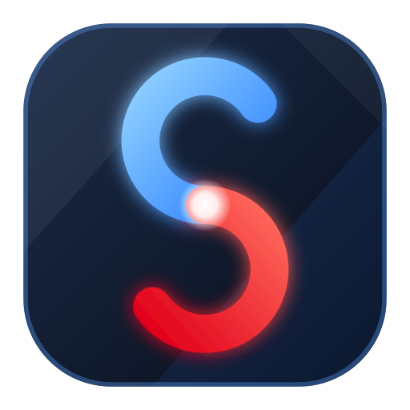
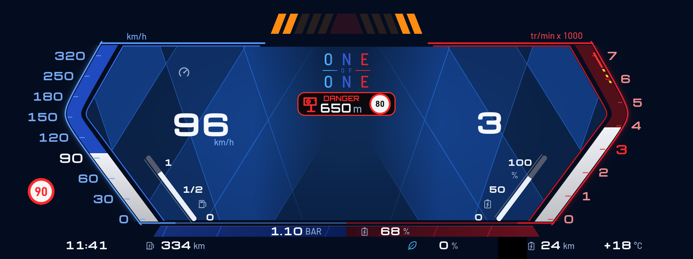
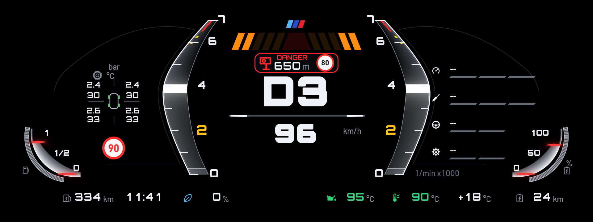
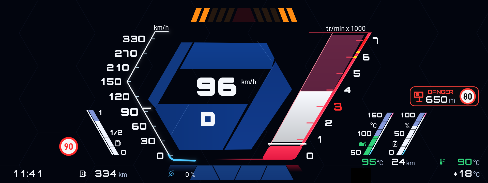
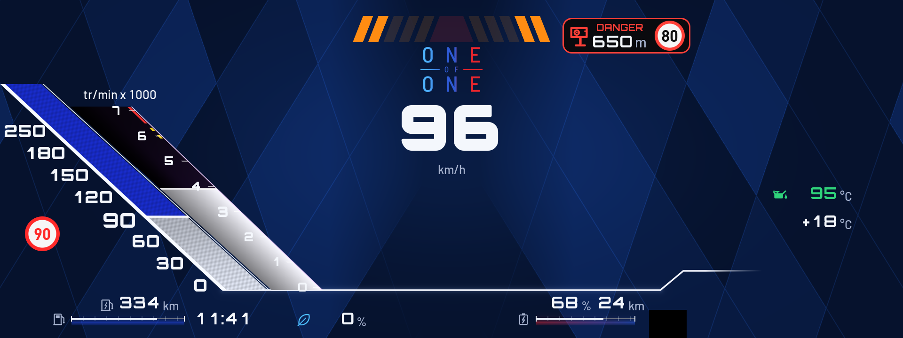
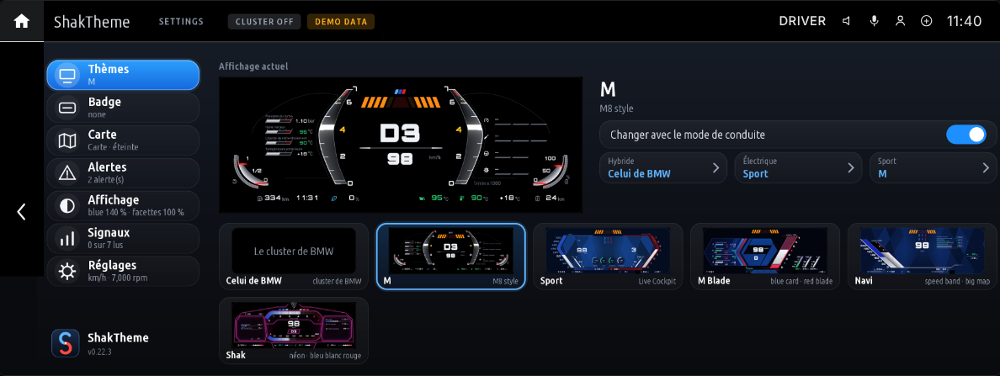

<h1 align="center">ShakTheme</h1>

Cluster themes for BMW iDrive 7 head units (MGU), by shakzer. Installed through the community MGU Store.

## ShakTheme

Redraws the whole instrument cluster in one of four themes: **Sport**, **M**, **M Blade** and **Navi**. Pick the theme on the center screen, or let it follow the drive mode (Hybrid, Hybrid Eco Pro, Sport Plus on a plug-in hybrid). It shows the battery and the electric range, oil and coolant temperatures that turn blue when cold, green when warm and flash red over their limit, a shift light, a window for the Waze map, and an energy flow in place of the boost when another app shares it. [Read more](apps/shaktheme/README.md)

## Setting up

Each app has its own menu on the center screen, opened from the apps menu, in the style of BMW's iDrive 8.5. Pick a theme or layout there, give each drive mode its own, and set your time zone and units.

## Install

1. Install **cluster-render** first. Both apps draw through it. It comes from the `robertnisipeanu/idrive-apps` Store source. With version 0.5.1 or newer, a cluster theme and a HUD layout can show at the same time.
2. In the Store, go to **Settings, Add source**, enter **`ShakHybridLab/apps`** (the repository was `shakzer/x3-hybride`; GitHub redirects it, but the Store may refuse the old name), and install the apps you want.
3. Open the app from the apps menu on the center screen to pick a theme or layout.
4. The head unit's clock runs on UTC, so set **Settings, Time zone (clock)** to your zone once (for example US Eastern). Named zones change for daylight saving by themselves.

The Store builds each app on the car from this repo. No BMW code is in it. Nothing has been tried on a car yet: each app's page says what has been checked and what is still open. Version history is in [CHANGELOG.md](../CHANGELOG.md).

## Use at your own risk

These are unofficial apps made by a hobbyist. They are not made, approved or supported by BMW, and the people who wrote them are not responsible for anything that happens to your car or to you while using them.

- Installing apps that don't come from BMW on your head unit is done at your own risk and may affect your warranty.
- The apps only read data from the car. They never write to or change any control unit.
- A cluster theme or HUD layout draws over BMW's own displays. Readouts are for information only: don't rely on them for safety, and always follow BMW's own warnings. If anything looks wrong, pick Off and BMW's display comes back.
- Don't set up or change the apps while driving. Keep your eyes on the road.
- The apps are provided as is, without any warranty, under the MIT licence. You use them entirely at your own risk.

## Licence

shakzer's changes and additions are MIT. The apps build on code under other free licences, whose notices stay with them: see [LICENSE](LICENSE), each app's `NOTICE` and the repository's [LICENSES.md](../LICENSES.md).
