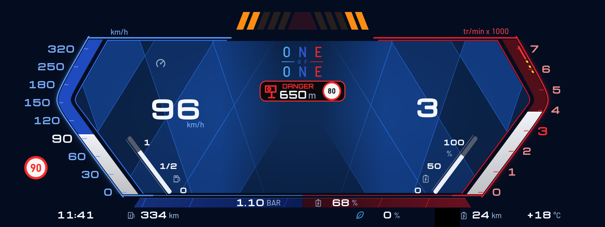
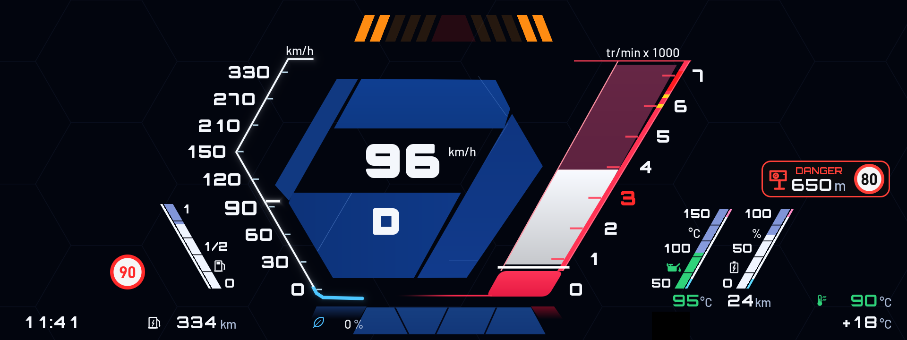
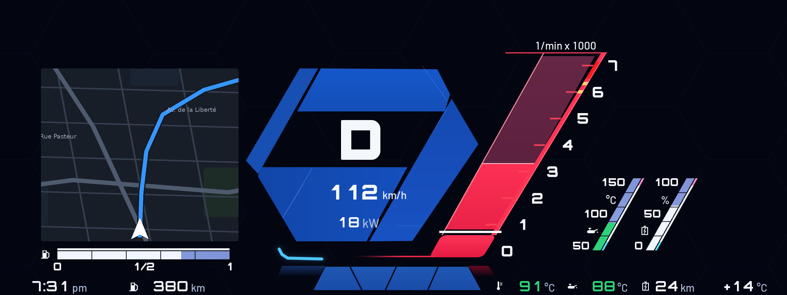
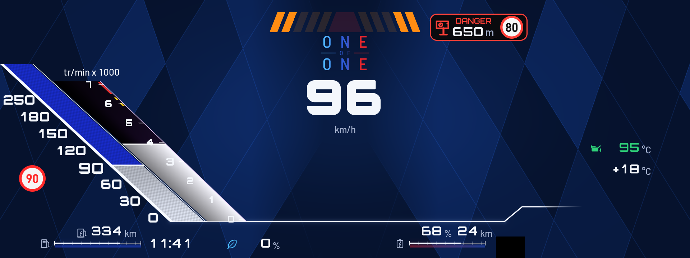
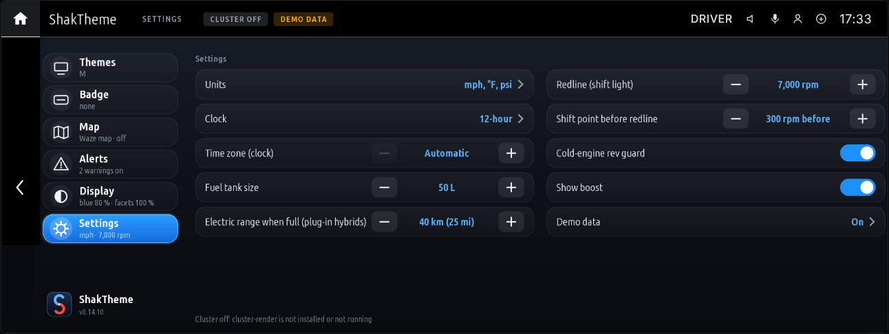

# ShakTheme

By shakzer. Redraws the whole instrument cluster of an iDrive 7 BMW in one of four themes: **Sport**, **M**, **M Blade** and **Navi**. Open **ShakTheme** from the apps menu on the center screen: its own menu (after BMW's iDrive 8.5) has the themes with pictures, the badge, the Waze map, warnings, display and settings.

## Themes

Four themes, plus BMW's own cluster.

### M

A current M8's cluster, traced off a photo of it and drawn on black.

- **Middle:** two bowed glass rev blades either side of the gear and speed, reading 0 to 7000 rpm like the M40i's own cluster. A red marker rides each blade at the rpm, the blade glows below it, and orange and red marks sit before and past your redline. The gear shows with its shifter programme: P, D3, S3 or M3.
- **Left:** a black card with a grey rim, filling the panel from top to bottom, with the tyre block: pressure and temperature at each corner round a car glyph (from the car's tyre monitor, read every 10 seconds, in the car's own units). The fuel dial sits over the card's lower corner, drawn like the M8's: a thin glass bracket inside a hatched chrome bezel, lit from the bottom up to the level, with a red streak at the level and another at the reserve.
- **Right:** what the engine, chassis, steering and gearbox are set to, as rows with a step bar (two above BMW's black gear box and two below it, since the car paints over that spot), and the oil temperature dial, the same glass bracket (blue streak at the cold end, red at the hot end). The rows follow the drive mode buttons: Hybrid, Electric, Electric Eco Pro, Sport, Sport Plus and Xtraboost. The car only reports that an Individual setup is on, not what each part is set to, so those rows read INDIVIDUAL.
- **Bottom:** range, the clock, and the outside temperature.

### Sport

The look of BMW's newer Live Cockpit Sport view.

- **Left:** speed as a blue bracket on BMW's 0 to 200 mph scale (0 to 320 km/h), with the digital speed and a fuel bar inside it.
- **Right:** revs as a red bracket on the M40i's 0 to 7000 rpm scale, with yellow and red marks around your redline, with the gear and an oil temperature bar inside it.
- **Middle:** deep navy with a lighter glow and a faceted pattern of lozenges, as on BMW's Sport view, or the Waze map with "Show Waze map inside the theme" on. The whole panel behind the brackets is navy too, not black (the setting "Blue background", 80 % by default, 0 = black).
- **Bottom:** boost in the blue and red strip (the battery's power in kW instead of it while eDrive Live shares one, see "Sport theme: energy flow"), plus the clock, range and outside temperature.

### M Blade

Copied from a photo of a BMW M cluster (traced on the photo, redrawn on the 1920x720 panel). Added next to M and Sport, they are not replaced. It has the same navy backdrop as the Sport theme instead of black, with faint hexagon outlines (setting "Blue background (Sport, M Blade, Navi)"; BMW's black gear box, which the car draws over the panel and cannot be removed, sits in a rounded dark window; the map window stays see-through).

- **Left:** the speed scale as a cyan line with a knee (a white marker at the speed, 0 to 330 km/h or 0 to 205 mph), the **fuel** as a thin slanted strip at its foot with 1, 1/2 and 0.
- **Middle:** the blue hexagon cut into panels, with the **gear letter big in the dark band** across it as in the photo (D, or S / M by the shifter programme, P R N; BMW's own black box shows it too) and the **speed small right under it** with "km/h" beside it; when eDrive Live shares the battery's power, the kW show under the speed. The **drive mode** is written on the four blue tabs under it.
- **Right:** the red rev blade (0 to 7000 rpm, marks around your redline, the stock-style shift light at the top, where BMW's own sits; with eDrive Live it is a **hybrid rev counter**, see below) and two slanted strips side by side, 130 px apart and aligned: the **oil temperature** (50 / 100 / 150 °C, lit blue below 75 °C, green when warm, flashing red over the limit) and the **hybrid battery** (0 / 50 / 100 %).
- **Bottom row, on one line and in the same lettering:** the clock, the fuel range, then the **coolant temperature** (blue below 70 °C), the **oil temperature** (blue below 75 °C; both coloured like the oil strip) and the **electric range** (km, under the battery strip), and the outside temperature at the right. The row clears BMW's belt light (x 587..626).
- **With the Waze map** ("Show Waze map inside the theme", or Cluster Centre / Cluster Info): the speed scale gives way to a narrow window at the left (561 x 422 px, x 80..641, y 167..589, as wide as the hood, the hexagon and the blade allow) with nothing drawn behind it. The hexagon is 8 % narrower (same height) and moves right, the blade 18 px (its "4" stays clear of BMW's black box) and the two strips 30 px, so nothing is tight against the map (the hexagon's left tip stays 18 px clear of it); the oil temperature, the electric range and the outside temperature under them move along, still in line with the clock and the fuel range, and the fuel becomes a flat bar under the map (pump icon, 0 / 1/2 / 1) instead of the slanted strip. The theme asks Waze on cluster to draw the map right in that window (`/dev/shm/cluster-info/map_window.txt`, Waze on cluster 0.9.107 or later). With an older version the file is ignored and the map stays in the centre (x 416..1504): set Waze on cluster's own map rectangle to x 80, y 167, 561 x 422. Not tried on a car.
- **Hybrid rev counter (M Blade, Sport and Navi; needs eDrive Live to share the battery's power):** while the engine runs (400 rpm and up) the blade (M Blade), the red bracket on the right (Sport) or the violet stripe (Navi) reads the rpm as on a combustion car. Driving on the battery alone it turns **blue** (light blue on Navi) and reads the electric power, 10 kW per mark, and the unit under the scale says "kW x 10". While the battery charges (recuperation), M Blade fills the **foot of the blade** under the 0 in **green** (full at 60 kW) and Sport turns its whole bracket and Navi its whole stripe **green** (engine at rest), and "CHARGE" appears beside the unit. The shift light follows the engine's rpm only, so it stays dark in electric. The M theme does not have it (on purpose). Without eDrive Live, or on a combustion car, only the rpm shows. The decision is in `shared/hybrid_tach.js`; not tried on a car.
- There is no ONE OF ONE lettering in this theme, and the rev scale reads 0 to 7 where the photo's reads 0 to 8.

### Navi

A diagonal speed band on the left, a big rounded window in the middle for the map and a thin line along the bottom, copied from the same screenshot.

- **Left:** the speed as a blue band running down to the lower right, with the speed scale along its edge, and the **rev counter** as the purple band beside it (marks 0 to 7 inside it, a white marker at the rpm, the unit above it; light blue in electric, green while charging, see the hybrid rev counter below). With the middle window closed, the speed is big in the centre (no gear: BMW's own black box already shows it); with it open, the band gets steeper and narrower to stay left of the window, and the gear and speed go big on the right.
- **Middle:** the map window (Waze on Cluster, or the pages of Cluster Centre and Cluster Info). Black with a thin outline when nothing shows in it.
- **Bottom:** a fuel bar with its range at the left, the clock, and a hybrid battery bar with its charge and electric range at the right. Oil and outside temperature are in the free space on the right.
- **Top:** the shift light, and under it, centred above the speed, the ONE OF ONE lettering (from the "lettering" setting). The lettering goes away while the middle window is open, so it never covers the Waze map.

Neither theme has been tried on a car; they are checked on the bench against the screenshot and for BMW's black gear box, seat-belt light and the hood. The gear letters use the app's own font, not the boxed one of the screenshot.

**Danger zone alert (M Blade and Navi, off by default).** Both can draw a Waze-style card while a danger zone is ahead: a camera, DANGER, the distance and, when it is known, the speed limit in a red ring. On M Blade it sits under the card on the right, on Navi in the top strip beside the shift light; both stay clear of the map window, so the map is never covered. **This app cannot find a zone by itself.** It has no position and no map data (CarPlay gives the car the picture of Waze's map and nothing else), so it only shows what another app tells it, through a file: `/dev/shm/cluster-themes/danger-<app>.json` with `{ "t": <ms since 1970, now>, "app": "<name>", "distance": <metres>, "limit": <km/h, optional> }`, rewritten about once a second (the card goes three seconds after the file stops; the nearest zone wins when several apps write). Nothing writes that file yet, so with the setting on the card stays hidden. The wording is "danger zone" on purpose: in France only zones may be announced, not the exact place or the kind of a speed camera (décret n° 2012-3); this is not legal advice. Checked on the bench with a fake source, not on a car.

## Couleurs d'alerte, réserve et loupe sur les chiffres (0.15.0)

- **Zones des barres (Sport, M, M Blade, Navi) :** les barres de régime et de vitesse sont **blanches** au départ puis passent au **rouge** dans la zone, avec un fondu doux (plus de saut de couleur) et sans orange : le jaune est réservé aux chiffres du M (voir 0.16.0). Régime : rouge à partir du réglage Redline (ou du point de passage s'il arrive avant). Vitesse : rouge à partir du réglage **Zone de vitesse** (130 km/h par défaut) ; 0 coupe la zone. Le M n'a pas de barre de vitesse (que les chiffres), donc seulement le régime.
- **Hybride :** le compte-tours hybride garde ses couleurs : **bleu** en électrique, **vert** en recharge. Les zones ne jouent que pour le régime du moteur.
- **Loupe très légère sur les chiffres de l'échelle :** le chiffre que l'aiguille **a atteint** (pas le plus proche : à 140 km/h c'est le « 120 » qui s'allume, pas le « 150 ») grossit un peu, environ +20 %, tant que sa barre est dans sa zone, et prend la couleur de la zone ; il s'éteint dès que l'aiguille repasse sous lui. Sur Navi, les chiffres du régime ne font que grossir (ils sont sur le fond de la barre). Les polices agrandies sont cuites par `tools/bake_fonts.py` (`s_scale_z`, `m_num_z`, `m_gl_z`, et les tailles intermédiaires `s_scale_m`, `m_num_m`, `m_gl_m`) et placées par `tools/zoom_labels.py` : rien ne touche la boîte noire de BMW, la veilleuse de ceinture ni la caméra.
- **Icônes de la même couleur que leur chiffre :** bleu à froid, vert à chaud, rouge qui clignote au-dessus de la limite (huile, liquide de refroidissement). Nouvelles icônes modernes (burette d'huile avec sa goutte, thermomètre à vagues, batterie avec éclair, pompe à essence) et la température extérieure a sa propre icône (`tempOut`).
- **Réserve en rouge :** l'autonomie essence à 90 km ou moins (réglage **Réserve : autonomie essence en rouge à partir de**) et la batterie à 10 % ou moins (réglage **Réserve : batterie en rouge à partir de**) passent au rouge, icône, chiffre et jauge, dans tous les thèmes et sur le HUD.
- **M avec la carte Waze, refait :** un filet argent fin entoure la fenêtre de la carte (avec une lueur à peine visible), et le rapport et la vitesse sont posés sur une **plaque** sous la carte, séparés par un fin trait vertical, avec « km/h » (ou « mph ») à droite de la vitesse. Plus petits, mieux centrés, ils laissent la carte respirer. Sans carte, le M est inchangé.
- Pas encore essayé sur la voiture : tout est vérifié sur le banc d'essai (captures normales, en zone orange et rouge, en électrique, en recharge, en réserve, en mph, avec et sans carte).

## Détails de finition (0.16.0)

- **Chiffre du régime sous l'aiguille :** dès 1000 tr/min, le chiffre que l'aiguille a atteint passe en **rouge** et grossit en douceur (d'abord ×1,1 puis ×1,2 dans la zone), puis s'éteint quand l'aiguille repasse dessous. Sur le **M**, ce chiffre est **jaune** (et les chiffres du milieu, rapport et vitesse, restent **blancs** ; la lame reste rouge). Sur Navi, le chiffre ne fait que grossir.
- **Hybride :** pendant que la barre montre la puissance de la batterie, le chiffre sous l'aiguille est **bleu clair** en électrique et **vert** en recharge (Sport, M Blade, Navi), comme la barre ; le moteur qui tourne le remet en rouge. Le M n'a pas de couleurs hybrides, par choix.
- **Repère de pointe :** un fin trait blanc reste 1,5 s à la valeur la plus haute du régime puis redescend sur l'aiguille (Sport, M, M Blade, Navi, HUD) ; il n'apparaît pas en hybride électrique.
- **Balayage au démarrage :** à l'allumage (voiture à l'arrêt), les barres montent au maximum puis redescendent en 1,6 s, une fois par thème affiché ; il s'arrête dès que la voiture roule. Réglage **Balayage des barres au démarrage** (activé).
- **Liseré argent autour de la carte Waze** sur Sport, M Blade et Navi, comme sur le M (refait en contour complet au 0.18.0).
- **Repères de zone rouge identiques sur les quatre thèmes (0.16.1) :** de petits traits jaunes dans les 700 tr/min avant le Redline, puis un trait rouge plein à partir de lui, le long du bord de l'échelle du compte-tours (ils suivent le réglage Redline et ne bougent pas avec le régime). Navi les a maintenant comme Sport, M et M Blade ; le HUD n'en a pas, sa barre devient déjà orange puis rouge.
- **Pneus (M) :** la pression passe au **jaune** sous le réglage **Pneus : pression en jaune sous** (2,0 bar par défaut ; 0 coupe) et au **rouge** 0,4 bar plus bas. Les températures gardent leur couleur.

## Détails de finition (0.17.0)

- **Autonomie totale :** le chiffre d'autonomie du bas est maintenant **carburant + électrique** (essence seule sur une voiture sans batterie), avec une icône qui le dit : la pompe avec l'éclair de la batterie dedans. Rouge quand le carburant est en réserve.
- **Roues du M :** chaque roue de la petite voiture vue de dessus est **verte**, **jaune** ou **rouge** selon sa pression, comme son chiffre (mêmes réglages que les pneus du 0.16.0).
- **Moteur chaud :** quand l'huile passe de froid à chaud pendant que l'appli tourne, l'icône et le chiffre clignotent trois fois en blanc, puis restent verts. Rien si le moteur était déjà chaud.
- **Chrono 0-100 km/h (0-60 mph en unités US) :** voiture à l'arrêt une demi-seconde, puis on accélère : un chronomètre (icône) compte en direct, puis le temps final reste **12 s** (vert si c'est un record, gardé dans `runs.json`). Il se met au centre, sous la vitesse (à gauche de la lettre du rapport sur M Blade), à la place de la bague de limitation. Réglage **Chrono 0-100 km/h (0-60 mph)**.
- **Bague de limitation de vitesse :** une bague blanche avec la limite, **rouge** (chiffre compris) dès que la vitesse affichée la dépasse. **L'appli ne peut pas trouver la limite seule** (ni position ni carte) : il faut une autre appli qui l'écrit dans `/dev/shm/cluster-themes/speedlimit-<appli>.json` avec `{ "t": <ms depuis 1970, maintenant>, "app": "<nom>", "limit": <km/h> }`, réécrit environ chaque seconde (un fichier de plus de 6 s est ignoré ; si plusieurs applis écrivent, le plus récent gagne ; la limite va de 5 à 200 km/h, toujours en km/h : le thème convertit en mph, arrondi à 5). Rien n'écrit ce fichier pour l'instant, donc la bague ne s'affiche pas tant qu'aucune appli ne le fait. Réglage **Bague de limitation de vitesse**. Ni la bague ni le chrono ne s'affichent quand la carte Waze est ouverte dans le thème (Waze montre déjà la limite).
- Pas de consommation instantanée (choix fait).

## Détails de finition (0.19)

- **Nom du mode de conduite en couleur :** Electric, Hybrid et Sport s'écrivent en bleu, vert et rouge sur Sport, M et Navi (sur le M, seul ce nom change ; sur M Blade il reste blanc, car il est posé sur l'onglet de l'hexagone, qui a déjà la couleur du mode).
- **Launch Control Ready (0.19.1) :** en mode Sport, voiture immobile, un **drapeau à damier** et « Launch Control Ready » s'affichent en vert à la place de la bague de limitation ; le chrono compte dès que la voiture démarre. Réglage **Drapeau « Launch Control Ready » (mode Sport, à l'arrêt)**. L'appli ne lit pas le launch control de la voiture (ni le frein) : c'est le chrono qui est prêt.

## Détails de finition (0.18.0)

- **Couleur selon le mode de conduite (Sport, M Blade, Navi) :** le thème est **bleu** en électrique / Eco Pro, **vert** en Hybride et **rouge** en Sport. Seuls ses propres bleus changent (supports, hexagone, fond, chiffres de vitesse) ; le bleu et le vert de l'hybride, l'huile froide et les avertissements gardent les leurs. Le M ne change pas. Réglage **Couleur du thème selon le mode de conduite** (activé par défaut ; le thème est reconstruit quand le mode change).
- **Contour de la carte Waze (Sport, M Blade, Navi) :** la fenêtre est entourée d'un petit jour sombre et d'un liseré argent, plus clair en haut, avec un léger ombrage sur le bord de la carte : elle paraît enchâssée dans le tableau de bord.
- **Alerte gel :** un flocon (clignote 8 s, puis reste allumé) et la température extérieure en bleu froid quand il fait au plus le réglage **Alerte gel : flocon sous** (3 °C par défaut, 0 = jamais) ; il s'éteint 1 °C au-dessus.
- **Part d'électrique du trajet (hybride rechargeable) :** une feuille et le pourcentage de kilomètres faits moteur éteint depuis le démarrage de l'appli (à partir de 0,3 km). Réglage **Part d'électrique du trajet** ; rien sur une voiture sans batterie.

## Off and drive modes

- **Off (BMW's own cluster):** pick it as the theme and the app draws nothing, so BMW's cluster comes back.
- **Sport theme: lettering at the top** (the upright, light stacked ONE / OF / ONE, number 4b, by default): thirteen "ONE OF ONE" / "1/1 EDITION" lettering options for the top centre of the Sport theme, painted in the M theme's colours as a gradient. It is our own lettering, not a brand's logo; it is hidden while the Waze map shows inside the theme. Navi also has it, centred under its shift light; M Blade has none. The images are baked by `tools/bake_emblems.py`.
- **Change with the drive mode** (on by default): the cluster follows the drive mode switch of a plug-in hybrid (X3 30e, no Comfort), with a theme for each of three slots: Electric Eco Pro (also Electric and Electric Individual), Hybrid (also Battery Control), and Sport Plus (also Sport, Sport Individual and Xtraboost). Out of the box, Sport Plus shows the M theme, Electric Eco Pro shows the Sport theme, and Hybrid leaves BMW's own cluster. Every theme also writes the real mode name small at the bottom right, as the car's own screen names it. Until the car reports a mode, the plain theme setting is used.
- **M cars:** the Efficient, Sport and Sport+ modes of M cars are not recognised yet, so the theme doesn't change with them. The last line of the Settings tab shows the value your car sends; please post it in an issue so it can be added.
- **With HUD Widgets:** on cluster-render 0.5.1 and newer, a cluster theme and a HUD layout show at the same time. On older cluster-render they share one screen slot and take turns: pick a theme while the HUD is on and the page asks whether to turn HUD Widgets off, and it asks the same the other way round.

## Settings

- **Theme**, and one per drive mode.
- **Show Waze map inside the theme:** Sport, M, M Blade and Navi open a window and Waze on Cluster draws its map in it, above BMW's own map view, so nothing shows twice (in the middle, except M Blade, whose window sits at the left as in the photo and is placed through `map_window.txt`, see M Blade above). When the map goes away the theme fills back in. While it is on, Waze's map on the HUD is off. Needs the Waze on Cluster app; turning it off gives Waze its usual place back.
- **Blue background (Sport, M Blade, Navi):** how strong the navy faceted backdrop is, in % of the car's own blue (80 % by default, 0 = pure black, up to 140 %). The car brightens dark tints, so set it by eye. The M theme keeps its black background.
- **Backdrop facets (Sport, M Blade, Navi):** how strong the lozenge pattern is, 0 to 100 % (100 % by default; 0 = plain navy).
- **Sport theme: energy flow (kW) in place of the boost** (on by default): the Sport theme's bottom strip shows the high-voltage battery's power in kW (negative = charging, recuperation) instead of the boost while another app shares it. eDrive Live 1.9.6 or later does, when this app asks for it (it writes its own `wanted-shaktheme.json` in `/dev/shm/cluster-info`, once a second, and removes it when the theme no longer needs it). When nothing shares the power, or eDrive Live stops (3 s without an update), the boost is shown as before. Off: the boost always stays. The other themes keep their boost.
- **Oil / Coolant temperature: blue below** (M theme): the oil and coolant readouts in the M theme's bottom row are blue while cold (under 75 °C for the oil, 70 °C for the coolant by default), green once warm, and flash bright red and dark red over their warning limit. 0 = never blue.
- **Danger zone alert (M Blade and Navi):** shows the alert card while another app reports a zone ahead (see the two themes above). Off by default; nothing appears until an app writes the file.
- **Badge:** the model name, like "BMW X3 M40i", as text in the theme's font (Sport and M, at the bottom). Off by default.
- **Warnings:** oil, coolant and boost limits. A readout over its limit flashes red (oil 130°C and coolant 115°C by default, boost off).
- **Test the shift lights:** runs the rpm up to the shift point for about 4 seconds while the car stands.
- **Night colours:** after sunset the theme's whites and greys dim to 60% (Auto, the default), or Off.
- **Units:** mph, °F, psi or km/h, °C, bar.
- **Clock:** 12-hour or 24-hour.
- **Time zone (clock):** the head unit's clock runs on UTC, so pick your zone once. Named zones (US Eastern, Central, Mountain, Pacific, Alaska, Hawaii, Arizona, Canada Atlantic, Mexico, UK / Ireland / Portugal, Central Europe, Eastern Europe) change for daylight saving by themselves; for anywhere else, pick your offset from UTC. Night colours uses the same zone to work out sunset.
- **Fuel tank size:** the fuel gauge asks the engine unit for the level in %. Where the engine unit doesn't answer, it works it out from the litres the car reports and this size (65 L on an X3, 59 L on a 3 Series).
- **Redline:** where the red marks start on the rev scales (they always cover at least the last 500 rpm, and the yellow marks sit in the 700 rpm before them).
- **Shift point before redline:** how far below the redline the shift lights peak (300 rpm by default).
- **Cold-engine rev guard:** until the oil reaches 80°C, the shift point starts at 4500 rpm and climbs as the oil warms up.
- **Show boost.**
- **Leave BMW's bottom strip clear** (off by default): the theme draws only above BMW's own bottom strip (range, clock, belt light, P), squeezed a little to fit. Try it if BMW draws black boxes over the theme: one M car owner found that leaving the strip clear stopped them (issue #5). Not yet tested on a car with this setting.
- **Leave room for the driver camera** (off by default): for newer cars with a driver attention camera in the top middle of the cluster, where other cars show the model badge. The shift light moves aside and M's logo is hidden. The camera's spot is taken from where the badge sits on a car without one. Not yet tested on a car with a camera; please report how it lines up on yours.
- **Demo data:** fake driving data for trying it out parked.
- **Calibration grid:** a theme that draws lines every 50 px with labels, for checking on a photo where things land on the real screen. It also carries a few test marks used to measure cluster-render's limits on the car.
- **Map calibration:** a theme that leaves BMW's whole map window open with a grid through it, for photographing exactly what shows through the map cut-out with a navigation map up.

**Shift grades:** every upshift is graded on its peak rpm. EARLY means more than 250 rpm under the shift point, LATE more than 200 over it, COLD REV the same while the cold guard is on, LIMITER within 25 rpm of the redline, and anything in between is SPOT ON. Only shifts aimed at the shift point are graded: one more than 1500 rpm under it (an everyday shift) or one the gearbox made itself in D or S is left out, and the last grade stays on screen. When Redline 2.0.28 or newer is running, the shift point and the grade come from Redline, which learns a shift point for each gear.

## Requirements

[cluster-render](https://github.com/robertnisipeanu/idrive-apps), installed from the `robertnisipeanu/idrive-apps` Store source. Version 0.5.1 or newer lets the theme show together with HUD Widgets.

## On the car

**Not tried on a car yet.** Everything was checked on the bench (the themes drawn frame by frame, the menu in the kit's emulator) and by automatic tests (`node tools/test_*.js`). To be checked in a real X3 30e:

- the four themes on the real screen, with and without the Waze map window;
- whether BMW's warning lights still show over the themes (start the car with a seat belt off and look);
- the battery charge and power readings, and the drive mode numbers the car sends;
- the clock with a named time zone, and the fuel % from the engine unit;
- the menu on the real centre screen (the emulator may differ a little).

If something looks wrong on your car, the last line of the Settings tab says what the app is doing and why anything is not drawn.

See [Use at your own risk](../../README.md#use-at-your-own-risk) before installing.

Version history is in the repo's [CHANGELOG.md](../../CHANGELOG.md).

## Licence

ShakTheme's changes and additions are by shakzer, under the MIT licence. The app builds on code under other free licences, whose notices must stay with it: see `NOTICE` and the repository's `LICENSE` and `LICENSES.md`.
